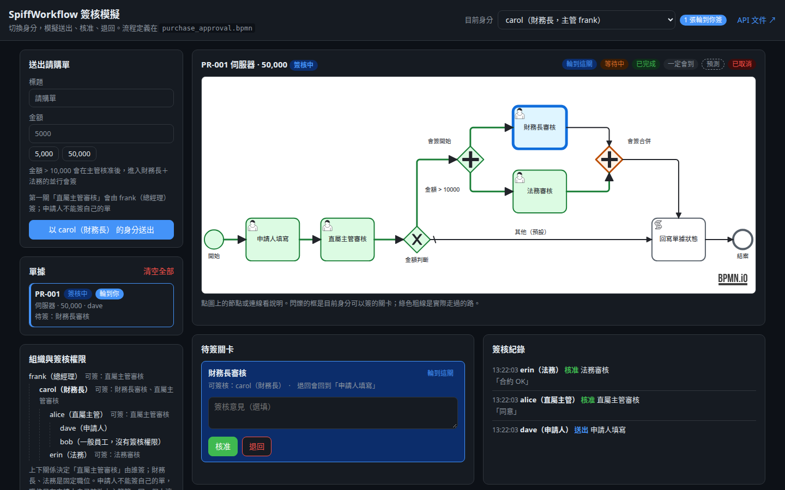
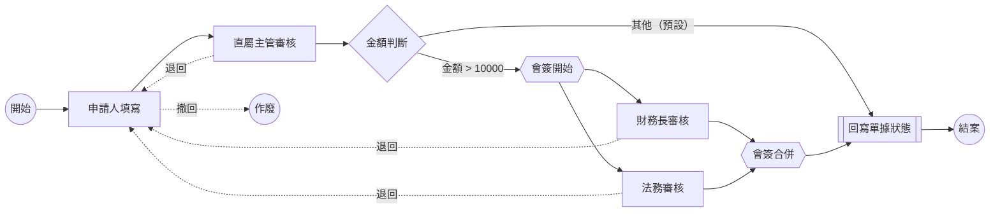
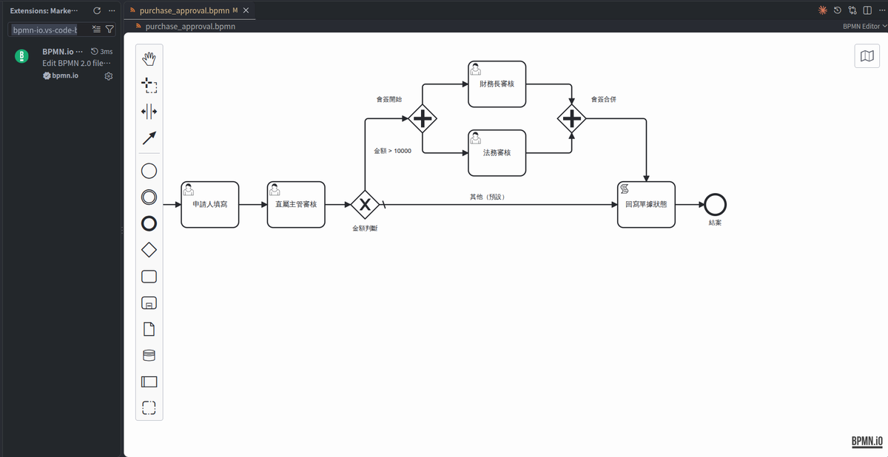

# spiffworkflow-approval-tutorial

用 [SpiffWorkflow](https://github.com/sartography/SpiffWorkflow)（純 Python 的 BPMN 引擎）+ FastAPI 模擬多角色簽核。

切換身分就能操作送出、核准、退回，並即時看到流程圖和引擎內部的狀態變化。



上圖是進行到一半的狀態：

法務已核准，「會簽合併」停在等待中（橘色），輪到財務長簽（藍色），綠色粗線是實際走過的路。

## 這個 repo 在示範什麼

- **流程定義和程式分開**：流程畫在 `purchase_approval.bpmn`，改門檻只需要改這個檔；誰來簽寫在 `workflow.py`。
- **SpiffWorkflow 的基本用法**：建立 workflow、完成任務、序列化存檔、退回給申請人（`reset_from_task_id`）、撤回作廢（`cancel`）。
- **並行會簽**：用 parallel gateway 讓兩個人同時簽，兩人都核准才往下走。
- **引擎內部狀態**：頁面會顯示 SpiffWorkflow 的 task tree，看得到 `LIKELY`、`MAYBE`、`WAITING` 這些狀態什麼時候出現。
- **引擎以外要自己做的事**：權限、單據狀態回寫、併發控制。SpiffWorkflow 只負責「流程走到哪一關」。

這是教學用的範例，資料存在 JSON 檔，也沒有登入機制，不適合直接拿去正式環境用。

沒有用到的 SpiffWorkflow 功能：多人會簽（multi-instance）、逾時（timer event）、泳道（lane）、DMN 決策表；子流程（call activity）只在 `tests/test_workflow.py` 裡示範。想繼續學可以看[官方文件](https://spiff.works/docs/spiffworkflow/)。

## 流程



實線是 `purchase_approval.bpmn` 裡畫的正常路徑。

虛線的退回、撤回不在 BPMN 裡，是 `workflow.py` 用程式做的，所以頁面上的流程圖看不到這幾條線。

改流程時這張圖要跟著 `.bpmn` 手動更新。

| 身分 | 角色 | 直屬主管 | 可以簽 |
|---|---|---|---|
| dave | 申請人 | alice | — |
| alice | 直屬主管 | carol | 直屬主管審核（dave、bob 的單） |
| carol | 財務長 | frank | 直屬主管審核（alice、erin 的單）、財務長審核、法務審核（erin 自己的單） |
| erin | 法務 | carol | 法務審核 |
| bob | 一般員工 | alice | —（用來測試沒有權限的情況） |
| frank | 總經理 | —（最高層，不能送單） | 直屬主管審核（carol 的單）、財務長審核（carol 自己的單） |

**規則摘要**（細節見[這個範例的業務規則](#這個範例的業務規則)）：

- 「直屬主管審核」由申請人的直屬主管簽，財務長、法務是固定職位。
- 申請人不能簽自己的單。
- 任何一關退回都回到申請人，改完可以重新送出，也可以撤回作廢。

## 安裝與執行

需要 Python 3.11 以上（FastAPI 用到的 Starlette 1.10 要求 3.11），實際只在 3.14.2 測過。以下用 pyenv 建立虛擬環境，用其他工具也可以：

```bash
git clone https://github.com/twtrubiks/spiffworkflow-approval-tutorial.git
cd spiffworkflow-approval-tutorial

pyenv virtualenv 3.14.2 spiffworkflow
pyenv local spiffworkflow

pip install -r requirements.txt
uvicorn main:app --reload
```

打開 <http://127.0.0.1:8000>。API 文件在 <http://127.0.0.1:8000/docs>，每支 API 都可以直接在上面試。

### 建議玩法

先玩這 5 步，看引擎怎麼走：

1. 用 **dave** 送出一張 50,000 的單。
2. 切換成 **alice** 核准，流程走到會簽，財務長和法務同時待簽。
3. 切換成 **erin** 核准，「會簽合併」變成等待中（`WAITING`）。
4. 切換成 **carol** 退回：單據回到申請人 dave，erin 簽過的也被清掉。
5. 切換成 **dave** 改金額重新送出，從主管重新簽；或直接撤回，整張作廢。

進階，這個範例自己的業務規則：

6. 切換成 **alice** 送一張 5,000 的單：第一關輪到 carol，alice 自己按核准會被擋下來（403）。
7. 切換成 **erin** 送一張 50,000 的單，再切換成 **carol** 核准：財務長、法務兩關都自動核准，直接結案。
8. 切換成 **carol** 送一張 50,000 的單，再切換成 **frank** 核准：財務長那關改由 frank 簽並自動核准，只剩法務 erin。

開兩個分頁、各自切成不同身分也可以，頁面每 4 秒會同步一次。

### 動手改一次流程

1. 用 **dave** 送一張 20,000 的單，先不要簽。
2. 打開 `purchase_approval.bpmn`，把 `flow_big` 這條連線的 `name="金額 &gt; 10000"` 和 `self.amount_total &gt; 10000` 都改成 30000。`&gt;` 是 XML 裡的 `>`；`name` 只是圖上顯示的文字，條件才是真正拿來判斷的。
3. 重啟 uvicorn。`--reload` 不會監看 `.bpmn`，要手動重啟。
4. 再用 **dave** 送一張 20,000 的新單。
5. 切換成 **alice**，兩張都核准：新單直接結案，舊單還是進入會簽。

舊單不受影響，是因為流程定義跟著單據一起存了，原因見「核心觀念」第 9 節。

頁面的流程圖是用目前的 `.bpmn` 畫的，所以舊單的圖上也會顯示 30000，但它實際上照舊的 10000 走。

想用拖拉的方式改，可以在 VS Code 安裝 [BPMN.io Editor](https://marketplace.visualstudio.com/items?itemName=bpmn-io.vs-code-bpmn-io)（擴充套件 ID `bpmn-io.vs-code-bpmn-io`），打開 `.bpmn` 就能直接拖拉節點、接線：



- 存檔會整份重寫 `.bpmn`：XML 註解會被拿掉，排版和字元寫法也會變（例如 `&gt;` 變成 `&#62;`），diff 會很雜。
- 條件、節點 id 這類設定，用文字模式改比較方便：命令面板輸入 `reopen`，選「用其他編輯器重新開啟」那一項，再選 Text Editor。
- `applicant_revise`、`manager_approve`、`cfo_approve`、`legal_approve`、`write_back` 這幾個 id 程式裡有用到，不能改名；新增的 userTask 要在 `workflow.py` 的 `APPROVERS` 設定誰來簽，不然沒人能簽。

練習完用 `git checkout purchase_approval.bpmn` 還原。

## 專案結構

```
├── purchase_approval.bpmn   # 流程定義：有哪些關卡、怎麼接、金額條件
├── workflow.py              # 審核邏輯都在這裡：誰能簽、核准、退回、重新送出、撤回、自動核准
├── main.py                  # FastAPI 路由，轉呼叫 workflow.py 的 ApprovalService
├── store.py                 # 用 JSON 檔模擬資料庫（data/requests.json）
├── static/index.html        # 操作頁（bpmn-js 畫流程圖）
├── tests/                   # pytest
└── examples/basic/          # 命令列版的基礎範例，沒有網頁，適合先看
```

「下一關是哪關」看 BPMN，由 SpiffWorkflow 去跑；「這一關誰能簽、簽完之後做什麼」看 `workflow.py`。

`main.py`、`store.py`、`index.html` 都沒有審核邏輯，頁面上的按鈕能不能按，也是看後端回傳的 `can_act`。

一次核准會經過這些地方：

```
POST /api/requests/{id}/approve      main.py
└─ ApprovalService.approve()         workflow.py
   ├─ _open()             從 JSON 讀出單據、還原 workflow，重新掛上 script engine
   ├─ _authorized_task()  用 approvers() 判斷這個人能簽哪一關，沒有就 403
   ├─ _complete()         task.complete() + do_engine_steps()，SpiffWorkflow 照 BPMN 往下走
   ├─ _log()              寫一筆簽核紀錄
   ├─ _auto_approve()     下一關的簽核人這一輪已經核准過，直接完成
   └─ _save()             序列化存回 JSON
```

建議閱讀順序：`purchase_approval.bpmn` → `workflow.py` 的 `approve()` → `approvers()` → `reject()`。

## 核心觀念

### 1. `.bpmn` 檔分成兩段

| 區塊 | 內容 | 誰會讀 |
|---|---|---|
| `<bpmn:process>` | 流程邏輯：節點、連線、條件、script | SpiffWorkflow 和畫圖工具 |
| `<bpmndi:BPMNDiagram>` | 圖面座標 | 只有畫圖工具（bpmn-js），SpiffWorkflow 會忽略 |

實務上不會手寫座標，而是用編輯器拖拉畫好再存檔，做法見上面的「動手改一次流程」。

### 2. 每次操作都是「讀出 → 操作 → 存回」

```python
workflow = serializer.deserialize_json(json_str)
workflow.script_engine = RecordScriptEngine(record)   # script engine 不會被序列化，一定要重新掛回去
task = workflow.get_tasks(state=TaskState.READY, manual=True)[0]
task.data["manager_approve_by"] = "alice"
task.complete()
workflow.do_engine_steps()                            # 自動往前跑，停在下一個 UserTask
json_str = serializer.serialize_json(workflow)
```

沒有重新掛回 script engine 的話，Gateway 條件裡的 `self.amount_total` 會讀不到單據。

### 3. Gateway 條件讀單據欄位

BPMN 裡寫 `self.amount_total > 10000`。`workflow.py` 的 `RecordScriptEnvironment.evaluate()` 會把單據物件放進 eval 的 context，名稱是 `self`。

### 4. `task.data` 會往下傳

每一關核准時寫進 `task.data` 的值，後面的節點和 Gateway 條件都讀得到。並行分支在合併節點會把兩邊的資料合在一起，所以結案時 `workflow.last_task.data` 裡同時有 `cfo_approve_by` 和 `legal_approve_by`。

### 5. 預測狀態：`LIKELY` 和 `MAYBE`

還沒走到的節點，SpiffWorkflow 會先預測：

| 狀態 | 意思 |
|---|---|
| `MAYBE` | 在 Gateway 有條件的分支上，可能會走到 |
| `LIKELY` | 在 Gateway 的預設分支上，大概會走到 |
| `FUTURE` | 一定會走到 |
| `READY` | 輪到這關 |
| `WAITING` | 已經走到，但條件還沒滿足（例如合併節點在等其他分支） |
| `COMPLETED` | 完成 |

Gateway 在還沒真正走到之前**不會先計算條件**，只看連線有沒有條件。所以就算金額是 50,000，主管核准前財務長那條仍然是 `MAYBE`。定義在 SpiffWorkflow 的 `util/task.py`，預測邏輯在 `specs/MultiChoice.py` 的 `_predict_hook`。

### 6. 並行會簽與合併

- 分岔後兩個 UserTask 同時是 `READY`。
- 先簽完的分支，合併節點變成 `WAITING`。
- 兩邊都到齊才往下走。task tree 裡合併節點會有兩份：後到的那份是 `COMPLETED`，先到的那份變成 `CANCELLED`。

### 7. 退回、重新送出與撤回

```python
# 退回：往上找「申請人填寫」那個 task，從它往下全部清掉重來
previous = task.parent
while previous and getattr(previous.task_spec, "bpmn_id", None) != APPLICANT_NODE:
    previous = previous.parent
workflow.reset_from_task_id(previous.id)

# 重新送出：申請人改完單據後完成「申請人填寫」，流程再往下走
task.complete()
workflow.do_engine_steps()

# 撤回：整張作廢
workflow.cancel()
```

退回不畫在 BPMN 裡，好處是 BPMN 只要畫正常路徑，退回規則集中在 `workflow.py`；代價是圖上看不出可以退回。`reset_from_task_id` 會清掉目標節點底下的所有 task，所以會簽中已經簽過的人也要重簽。

### 8. SpiffWorkflow 不管的事

- **權限**：BPMN 的 UserTask 裡完全沒有「誰來簽」的資訊，誰能簽哪一關是 `ApprovalService.approvers()` 自己判斷的，規則見「這個範例的業務規則」。
- **自動核准**：SpiffWorkflow 不知道誰簽了哪一關，同一個人連續簽核也要自己處理。`_auto_approve()` 判斷「這一輪」的方式，是看 task tree 上還留著的已完成簽核 task：退回時 `reset_from_task_id` 會把它們清掉，所以不用另外記。
- **單據狀態**：BPMN 的「回寫單據狀態」是 scriptTask，自訂的 `RecordScriptEngine.execute()` 跑到這一關時會把單據改成 approved。
- **併發**：會簽的兩個人同時按核准時，各自「讀出 → 操作 → 存回」會互相蓋掉。`store.py` 用一把鎖把整段操作包起來，`tests/test_workflow.py` 裡有對應的測試。

### 9. 改程式後，進行中的單據會怎樣

單據存的是「當時的流程定義」和「走到哪一關」，誰能簽則是每次操作才算。所以改程式時要看改的是哪一層：

| 改了什麼 | 進行中的單據 | 原因 |
|---|---|---|
| `workflow.py` 的簽核規則（`approvers()`、`APPROVERS`、自動核准） | 馬上生效 | 每次操作都重新算 |
| `RecordScriptEngine` 的腳本動作 | 還沒跑到的節點會用新程式 | 每次讀單都重新掛上 script engine |
| `purchase_approval.bpmn`（節點、連線、Gateway 條件） | 不生效，只影響新單 | 序列化時整份流程定義也存進 JSON 的 `spec`，讀回來用的是存檔裡那份 |
| `MANAGER_OF` 組織表 | 不生效，只影響新單 | 送出時就把主管記進單據的 `manager` 欄位 |

`tests/test_workflow.py` 的 `test_bpmn_change_only_affects_new_requests` 把金額門檻改成 100,000：舊單照 10,000 走到會簽，新單直接結案。

要注意的地方：

- **BPMN 改了，按「重新送出」也沒用**：重新送出是在同一個 workflow 裡 `reset_from_task_id`，流程定義還是舊的。要讓舊單走新流程，只能撤回再送一張新的。例如加入「申請人填寫」之前送出的單，流程裡沒有這個節點，退回時會整張作廢。
- **自動核准不會主動補做**：規則改了之後，已經停在某一關的單不會自己往下走，要等下一次有人核准時才會檢查。
- **不要改節點 id**：把 `cfo_approve` 改名、`APPROVERS` 也跟著改的話，舊單的流程定義裡還是 `cfo_approve`，查不到簽核人，會卡住沒人能簽。
- **不要刪除或改名 `PurchaseRequest` 的欄位**：讀單是 `PurchaseRequest(**data["record"])`，舊資料裡多出不認得的欄位會直接 `TypeError`。新增欄位要給預設值，`manager` 就是這樣加的。
- **改 `.bpmn` 要手動重啟伺服器**：`.bpmn` 只在啟動時讀一次，`uvicorn --reload` 只監看 `*.py`。`--reload-include '*.bpmn'` 要另外安裝 `watchfiles` 才有作用，`requirements.txt` 沒有裝。

## 這個範例的業務規則

這些是範例自己定的規則，跟 SpiffWorkflow 無關，都寫在 `workflow.py`。

**簽核人規則**：「直屬主管審核」由申請人的直屬主管簽（`workflow.py` 的 `MANAGER_OF`），不是固定某個人；財務長、法務是固定職位（`APPROVERS`）。不管哪一關，申請人都不能簽自己送出的單，所以 alice 自己送的單是由 carol 簽第一關。固定職位如果只有申請人自己（法務只有 erin），這一關改由申請人的直屬主管簽，不然 erin 自己送的大額單會卡在法務審核，沒有人能簽。

**自動核准**：同一個人這一輪已經核准過，之後輪到他的關卡會自動核准，簽核紀錄會寫一筆「自動核准」，註明他之前在哪一關核准過。carol 同時是 alice、erin 的主管和財務長，所以 alice、erin 送的大額單，carol 只要簽一次。被退回、重新送出後是新的一輪，之前的核准不算。

代價是 erin 自己送的單實際上沒有另一位法務審過。這個範例只有一位法務，實務上通常會設代理人。

**退回規則**：「申請人填寫」是申請人自己的關卡，送出時程式直接完成它。不管在哪一關退回，單據都回到這一關（`returned`），申請人可以改標題、金額後重新送出，流程從直屬主管重新開始，會簽中已經簽過的也要重簽；也可以撤回，整張作廢。結案前申請人隨時可以撤回，不限於被退回時。

## API

| 方法 | 路徑 | 說明 |
|---|---|---|
| GET | `/api/users` | 所有角色、每個人的直屬主管，以及每個人可以簽哪幾關 |
| GET | `/api/bpmn` | 流程定義（BPMN XML） |
| GET | `/api/requests?user=` | 單據列表，`my_turn` 表示這個人現在有關卡可以簽 |
| POST | `/api/requests` | 送出請購單；沒有直屬主管的人（frank）不能送，回 403 |
| GET | `/api/requests/{id}?user=` | 單據明細：節點狀態、task tree、簽核紀錄 |
| POST | `/api/requests/{id}/approve` | 核准；申請人簽自己的單回 403 |
| POST | `/api/requests/{id}/reject` | 退回給申請人修改 |
| POST | `/api/requests/{id}/resubmit` | 被退回後，申請人改完標題、金額重新送出；不在申請人手上回 409 |
| POST | `/api/requests/{id}/withdraw` | 申請人撤回，整張作廢；結案前隨時可以 |
| GET | `/api/requests/{id}/workflow-json` | SpiffWorkflow 序列化後的原始 JSON |
| DELETE | `/api/requests` | 清空所有單據 |

錯誤代碼：沒有權限 403、已結案／已作廢／不在該關卡 409、找不到單據 404、參數錯誤 422。

## 注意事項

- **`serviceTask` 預設不會執行**：SpiffWorkflow 3.2.0 用預設的 `BpmnParser` 時，`serviceTask` 不會呼叫 `script_engine.execute()`，任務會停在 `STARTED`，序列化時還會丟出 `TypeError: Object of type ServiceTask is not JSON serializable`。所以範例用 `scriptTask`。原因是 `ServiceTask` 繼承的 `ScriptEngineTask._execute()` 是空的（`bpmn/specs/mixins/script_task.py`）。
- **升級要注意序列化格式**：存起來的 JSON 會帶版本號，`deserialize_json()` 會自動做舊格式轉換（`bpmn/serializer/migration/`）。存檔時用 `serialize_json()`、讀檔時用 `deserialize_json()`，不要自己拼 dict。
- **lxml 不接受帶 encoding 宣告的 str**：`add_bpmn_str()` 之前要先拿掉 `<?xml ... encoding="UTF-8"?>`。

## 測試

```bash
pip install -r requirements-dev.txt
pytest
```

## 測試過的版本

| 套件 | 版本 |
|---|---|
| Python | 3.14.2 |
| SpiffWorkflow | 3.2.0 |
| FastAPI | 0.162.0 |
| uvicorn | 0.54.0 |
| bpmn-js（CDN） | 17.11.1 |

## License

MIT
