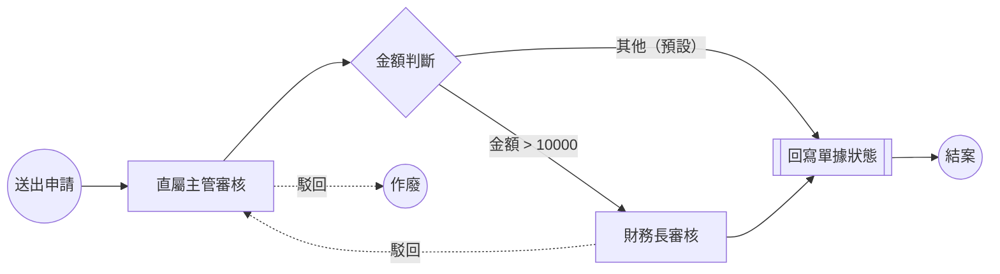

# 基礎範例：命令列版

沒有網頁、沒有 FastAPI，用一支 Python 把 SpiffWorkflow 的核心用法跑一遍。適合先看懂引擎怎麼用，再去看根目錄的網頁版。

| 檔案 | 內容 |
|---|---|
| `spiff_approval_demo.py` | 程式，跑三個固定情境並印出每一步的節點狀態 |
| `spiff_approval_demo.bpmn` | 流程定義（兩關，沒有會簽） |
| `spiff_approval_demo.html` | 流程圖檢視頁，直接用瀏覽器打開 |

## 執行

在 repo 根目錄：

```bash
python examples/basic/spiff_approval_demo.py
xdg-open examples/basic/spiff_approval_demo.html   # 看流程圖（macOS 用 open）
```

檢視頁用 bpmn-js 從 unpkg CDN 載入，所以要能連網。點圖上的節點或連線，會顯示它在 XML 裡的定義，下方 XML 也會標出對應的行。

頁面裡內嵌了一份 `.bpmn` 的內容，因為瀏覽器不允許 `file://` 頁面讀取本機檔案。改了 `.bpmn` 之後，把檔案拖進畫布就能看到新版本。

## 流程



實線是 `spiff_approval_demo.bpmn` 裡畫的正常路徑。

虛線的駁回不在 BPMN 裡，是 `spiff_approval_demo.py` 的 `reject()` 用程式做的：退回上一關，上一關是 StartEvent 就整張作廢。

改流程時這張圖要跟著 `.bpmn` 手動更新。

| 關卡 | BPMN 節點 | 可簽核的人 |
|---|---|---|
| 直屬主管審核 | `userTask` `manager_approve` | alice |
| 財務長審核 | `userTask` `cfo_approve` | carol |
| 回寫單據狀態 | `scriptTask` `write_back` | 系統自動執行，把單據 state 改成 approved |

三個情境：

1. **小額 5,000**：主管核准後直接結案。
2. **大額 50,000**：
   - bob 沒權限，簽不了。
   - 主管核准後走到財務長；財務長駁回，退回主管。
   - 主管再核准、財務長核准後結案，最後印出簽核紀錄。
3. **主管直接駁回**：上一關是 StartEvent，整張作廢，作廢後不能再簽。

## 整合進實際系統時的對應

如果要把這套整合進實際的系統，各部分大致可以這樣對應：

| 實際系統 | 範例 |
|---|---|
| 前端 bpmn-js 畫好、存在資料庫的 BPMN XML | `spiff_approval_demo.bpmn` |
| 流程實例存 workflow JSON 的欄位 | `FakeDB` |
| 每個節點設定的簽核人（使用者 / 群組） | `APPROVERS` 字典 |
| 業務單據（請購單、訂單…） | `PurchaseRequest` dataclass |
| 自訂的 script engine | `RecordScriptEngine` / `RecordScriptEnvironment` |
| 節點觸發的系統動作 | `NODE_ACTIONS` 字典 |

## 跟網頁版的差異

| | 這個範例 | 根目錄的網頁版 |
|---|---|---|
| 流程 | 兩關 | 多了財務長＋法務的並行會簽 |
| 簽核人 | `APPROVERS` 固定名單 | 第一關依申請人的直屬主管決定，申請人不能簽自己的單 |
| 駁回／退回 | 退回上一關，第一關駁回整張作廢 | 一律退回申請人，可修改後重新送出或撤回 |
| 作廢 | 只在 `FakeDB` 標記，workflow 本身不知道 | 呼叫 `workflow.cancel()`，task tree 裡的節點會變成 CANCELLED |
| 資料 | 存在記憶體 | 存在 `data/requests.json` |

核心觀念（script engine 要重新掛回、`task.data` 往下傳、LIKELY / MAYBE 預測狀態等）寫在根目錄的 [README](../../README.md)。
